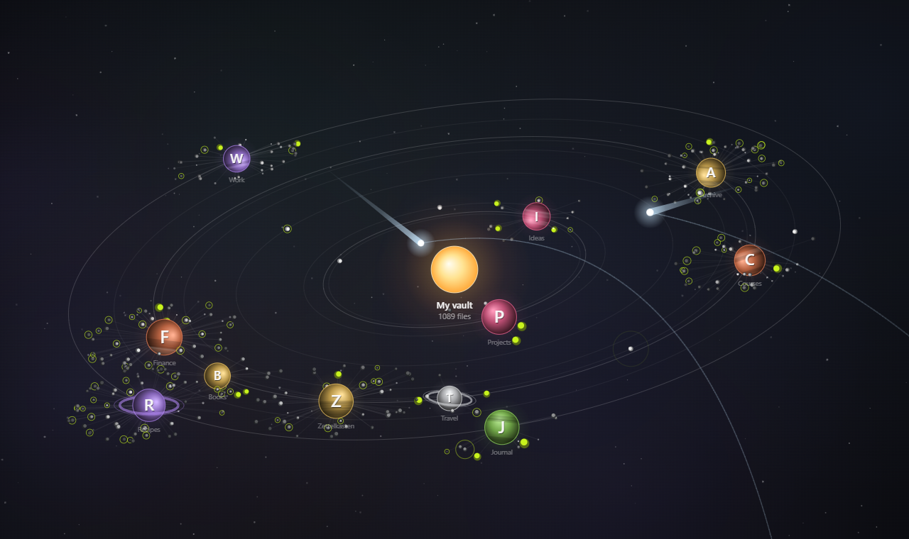

# Orbit Folders

Explore your vault as an animated star system. The current folder is the star, its subfolders are planets on orbits, and notes circle around them as moons.

[Русская версия](./README.ru.md)

## Features

- **Folders as planets.** Each subfolder of the current folder travels along an orbit around the star. Planets are lit from the star's side and can have bands and rings.
- **Notes as moons.** Files circle their folder in the same plane as the system's orbits. Files closer to the folder are brighter, the ones farther out fade away.
- **Files of the current folder** fly around the star on their own visible orbits.
- **Stable layout.** A folder's orbit and position depend only on its path, so things stay where you remember them.
- **Navigation.** Click a planet to make it the new star, click the star or the breadcrumbs to go back up, click a moon to open the note.
- **Reacts to the pointer.** Nearby nebulae brighten, planets and notes light up, and folder labels grow as you get closer.
- **Ambient effects.** Signals ripple out from random notes, and comets fly through the system with a tail that grows near the star and a fading trail.
- **Per-folder customization.** Color, icon (emoji or letters), pinned orbit and visibility for every folder.
- **Interface in English and Russian.** Follows Obsidian's language by default.

## Usage

1. Open the view with the orbit icon in the ribbon or the **Orbit Folders: Open orbit view** command.
2. Use the mouse:

| Action | Result |
| --- | --- |
| Click a planet | Enter the folder: it becomes the star |
| Click the star or a breadcrumb | Go up |
| Click a moon | Open the note (Ctrl/Cmd+click opens a new tab) |
| Right-click a planet | Customize, hide, or use the regular file menu |
| Drag / scroll wheel | Pan / zoom |
| Double-click empty space | Fit the system to the view |

3. Use the buttons in the top-right corner to pause the animation, fit the view or open the settings.

## Settings

| Section | What you can change |
| --- | --- |
| General | Language, root folder, excluded folders, hiding empty folders |
| Orbits | Number of orbits, radius, spacing, tilt, rotation, line opacity, stable layout |
| Motion | Overall, folder and file speed, speed variation, alternating directions, pause on hover |
| Folders | Planet size, size by file count, labels, icons, center style and size |
| Files | Files and subfolders, files from nested folders, file orbits, dot limit, spread, rays, color by type, recent file highlight |
| Appearance | Background (space or Obsidian theme), stars, nebulae, pointer effects, accent color |
| Effects | Signals (sources and interval), comets (interval) |
| Individual folders | Visibility, color, icon and pinned orbit for each folder |

## Installation

### From the community plugins directory

1. Open **Settings → Community plugins** and turn off restricted mode if needed.
2. Select **Browse**, search for **Orbit Folders**, then select **Install** and **Enable**.

### Manually

1. Download `main.js`, `manifest.json` and `styles.css` from the latest release.
2. Put them in `<your vault>/.obsidian/plugins/orbit-folders/`.
3. Reload Obsidian and enable **Orbit Folders** in **Settings → Community plugins**.

## Privacy

The plugin only reads the folder and file structure of your vault (names, sizes and modification dates) to draw the view. It doesn't read note contents, doesn't make network requests and doesn't collect any data.

## Development

The plugin is written in plain JavaScript without a build step: `main.js` is both the source and the release file.

To publish a new version:

1. Update `version` in `manifest.json` and add the new version to `versions.json`.
2. Commit, then create and push a tag with exactly the same version, for example `git tag 1.0.1 && git push origin 1.0.1`.
3. The GitHub Actions workflow creates a draft release with `main.js`, `manifest.json` and `styles.css`. Review it and publish.

## License

[MIT](./LICENSE)
