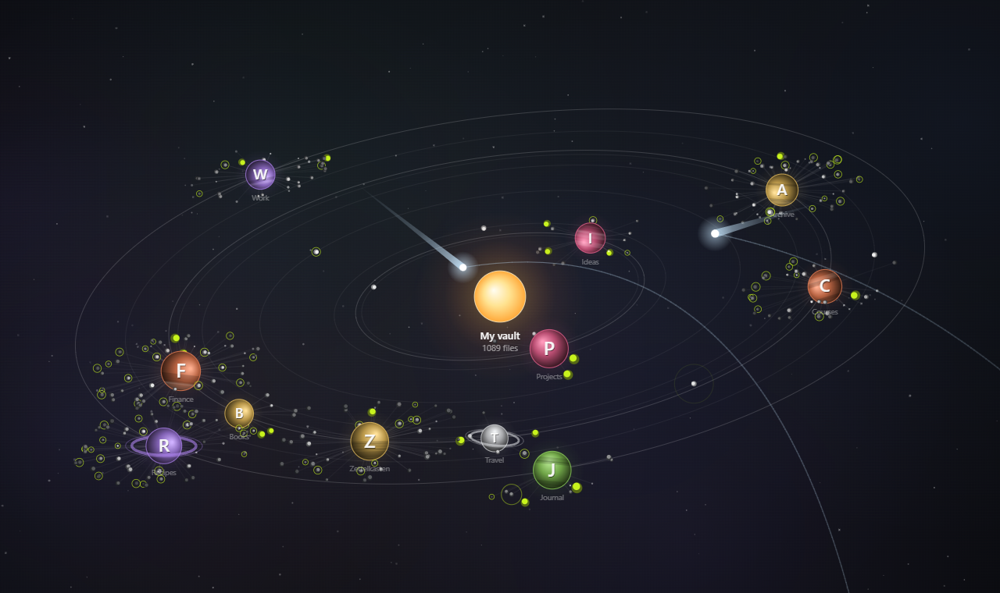

# Orbit Folders

Хранилище Obsidian в виде анимированной звёздной системы. Текущая папка — звезда, её подпапки — планеты на орбитах, а заметки летают вокруг них как спутники.

[English version](./README.md)

## Возможности

- **Папки — планеты.** Каждая подпапка текущей папки движется по орбите вокруг звезды. Планеты освещены со стороны звезды, у некоторых есть полосы и кольца.
- **Заметки — спутники.** Файлы обращаются вокруг своей папки в той же плоскости, что и орбиты системы. Ближние к папке — ярче, дальние — тусклее.
- **Файлы текущей папки** летают вокруг звезды по собственным видимым орбитам.
- **Постоянное расположение.** Орбита и место папки зависят только от её пути, поэтому всё остаётся там, где вы это запомнили.
- **Навигация.** Клик по планете делает её новой звездой, клик по звезде или по пути вверху — шаг назад, клик по спутнику открывает заметку.
- **Реакция на курсор.** Рядом с курсором светлеют туманности, подсвечиваются планеты и заметки, а подписи папок растут.
- **Фоновые эффекты.** От случайных заметок расходятся сигналы, через систему пролетают кометы: у звезды хвост длиннее, за кометой остаётся гаснущий след.
- **Настройка отдельных папок.** Цвет, значок (эмодзи или буквы), закреплённая орбита и видимость.
- **Интерфейс на русском и английском.** По умолчанию — как язык Obsidian.

## Как пользоваться

1. Откройте вид значком орбиты на левой панели или командой **Orbit Folders: Открыть орбиты папок**.
2. Управление мышью:

| Действие | Результат |
| --- | --- |
| Клик по планете | Войти в папку: она становится звездой |
| Клик по звезде или по пути вверху | Подняться на уровень выше |
| Клик по спутнику | Открыть заметку (Ctrl/Cmd+клик — в новой вкладке) |
| Правый клик по планете | Настроить, скрыть или открыть обычное меню файла |
| Перетаскивание / колесо | Сдвиг / масштаб |
| Двойной клик по пустому месту | Вписать систему в окно |

3. Кнопки в правом верхнем углу: пауза, вписать в окно, настройки.

## Установка

### Из каталога сторонних плагинов

1. Откройте **Настройки → Сторонние плагины** и при необходимости выключите безопасный режим.
2. Нажмите **Обзор**, найдите **Orbit Folders**, затем **Установить** и **Включить**.

### Вручную

1. Скачайте `main.js`, `manifest.json` и `styles.css` из последнего релиза.
2. Положите их в `<хранилище>/.obsidian/plugins/orbit-folders/`.
3. Перезагрузите Obsidian и включите **Orbit Folders** в **Настройки → Сторонние плагины**.

## Конфиденциальность

Плагин читает только структуру папок и файлов (названия, размеры и даты изменения), чтобы нарисовать систему. Содержимое заметок он не читает, в сеть не обращается и никаких данных не собирает.

## Лицензия

[MIT](./LICENSE)
